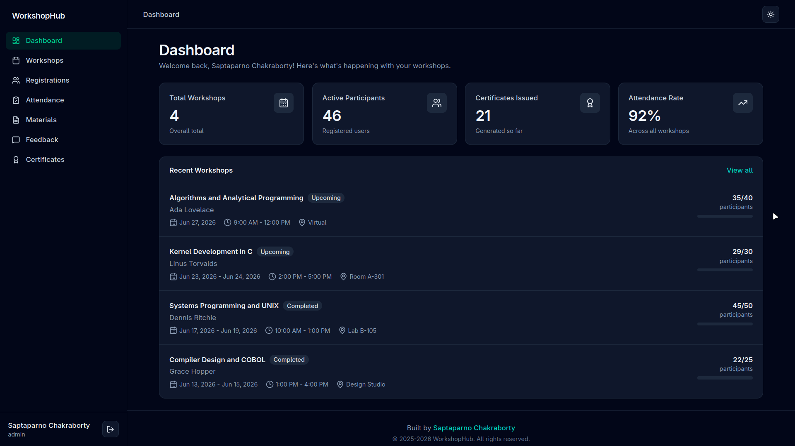
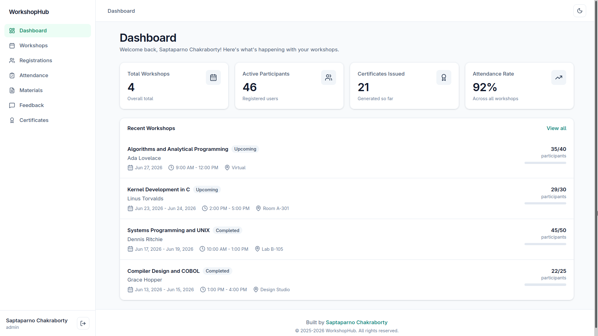
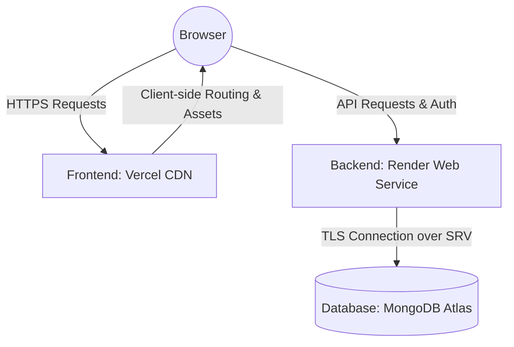
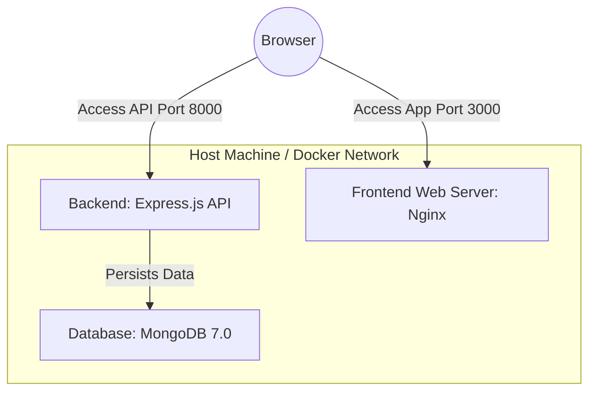
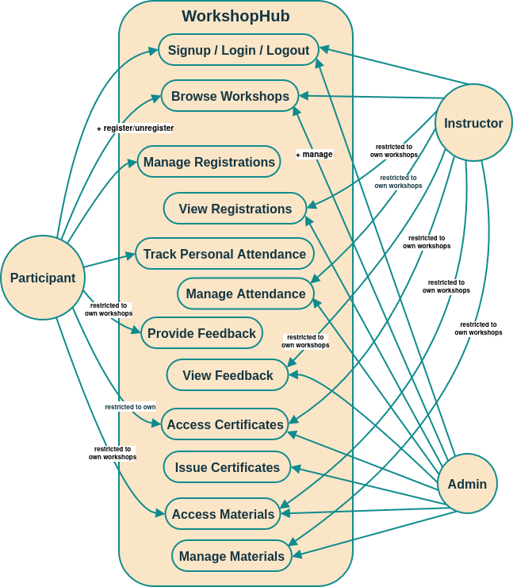

# WorkshopHub

<!-- markdownlint-disable MD033 -->
<p align="left">
  
  
  
  
  
  
  
  
  
  
  
</p>
<!-- markdownlint-enable MD033 -->

This project is a full-stack application built with Node.js, Express.js, MongoDB, and React.js for managing the full lifecycle of educational workshops.  
The application handles workshop creation, registrations, attendance tracking, feedback collection, material distribution, and certificate generation while strictly enforcing role-based access control (RBAC).  
It aims to streamline the entire workshop lifecycle for admins, instructors, and participants.

> [!IMPORTANT]  
> **Project Status: Complete**  
> WorkshopHub is a completed personal learning and portfolio project developed independently by [me](#author).  
> While the core features have been fully implemented, the project might still receive occasional refinements and bug fixes in the future by [me](#author). Feedback and discussions are always welcome, but the repository is not intended for external contributions.

---

## Live Deployment

WorkshopHub is hosted on: https://workshophub-taupe.vercel.app

> [!NOTE]  
> Because the backend is hosted on Render's free tier, the web service automatically spins down after periods of inactivity. If the service is idle, the initial request may take 30 to 50 seconds to wake up. Subsequent requests will respond normally.

---



<details>
<summary><b>Toggle light-theme admin dashboard preview</b></summary>



</details>

> [!NOTE]  
> These screenshots display placeholder data (names of legendary programmers as instructors and workshop names related to their projects/expertise) used for testing during development.

---

## Tech Stack

- **Backend:** Node.js, Express.js
- **Database:** MongoDB (MongoDB Atlas in production)
- **ODM:** Mongoose
- **Authentication:** JWT-based authentication
- **Password Hashing:** Bcrypt (for secure password storage)
- **Cloud Hosting:** Vercel (Frontend), Render (Backend), MongoDB Atlas (Database)
- **Containerisation:** Docker, Docker Compose
- **Testing/Debugging Tools:** Postman, Browser DevTools
- **Frontend:** React, Tailwind CSS, Vite
- **Web Server:** Nginx (serving the optimised frontend build in Docker)
- **Certificate PDF Generation:** `pdfkit`
- **Toast Notifications:** `react-hot-toast`
- **Icons:** `lucide-react`

---

## Architecture & Infrastructure

### Cloud Deployment Architecture

In production, the application is decoupled into independently hosted frontend, backend, and managed database layers:



### Local Docker Architecture

I containerised the entire application using Docker and Docker Compose to make local execution reproducible and to avoid configuration differences across systems.



- **Multi-Stage Build:** Configured a multi-stage Dockerfile for the frontend to compile React with Node.js and serve the static files using Nginx. This keeps the production image extremely small (under 30MB).
- **Network Isolation:** The database, backend, and frontend run in their own containers within a private bridge network.
- **Data Persistence:** Used a named volume (`mongo_data`) so that data persists even when the containers are stopped or rebuilt.

---

## Running Locally (Docker)

This project is a personal solo build and is not open to external contributions. For testing, demonstration, or reviewing the application locally outside the live cloud deployment, I use Docker Compose. It provides a reproducible multi-container environment with zero manual configuration.

### 1. Start Services

Spin up all containers in the background:

```bash
docker compose up --build -d
```

- **Frontend:** `http://localhost:3000`
- **Backend API:** `http://localhost:8000/api`

### 2. Seed Sample Data (Optional)

Populate the local database with sample data inside the backend container:

```bash
docker compose exec backend node scripts/seed.js
```

### 3. Stop Containers

Shut down and clean up running containers:

```bash
docker compose down
```

---

### Exploring the Application (Demo Mode)

For reviewing role-specific interfaces locally or on the live deployment:

- **One-Click Demo Mode:** On the login page (`/login`), click any quick role button (**Admin**, **Instructor**, or **Participant**) to sign in immediately without typing credentials. When operating in demo mode, mutating requests (POST, PUT, PATCH, DELETE) are rejected by middleware to safeguard sample records.
- **New User Registration:** You can register a brand new account directly from the signup page in your browser to experience participant enrollment, attendance tracking, and certificate generation from scratch.

---

## Key Features

- **Authentication & RBAC:** Secure JWT-based authentication with bcrypt password hashing and strict role-based access control for Admins, Instructors, and Participants.
- **Showcase Demo Mode:** Built-in one-click sign-in buttons for all three roles, with route-level mutation guards to safeguard sample records from accidental alteration.
- **Workshop Management:** Comprehensive workshop lifecycle handling including creation, editing, scheduling, capacity caps, and status tracking.
- **Participant Registration:** Real-time workshop enrolment and cancellation workflows with seat availability checks.
- **Attendance Tracking:** Session attendance management restricted to assigned workshop instructors and platform administrators.
- **Learning Materials:** Material distribution supporting external study links and workshop resources.
- **Feedback & Ratings:** Participant feedback collection with numerical ratings and qualitative reviews.
- **Certificate Generation:** Dynamic, downloadable PDF certificates generated on the fly with `pdfkit` for eligible attendees.
- **Modern Responsive Interface:** Clean user interface styled with Tailwind CSS, supporting both dark and light visual themes.
- **Robust RESTful API Architecture:** Modular controllers, route separation, centralized error handling, and health monitoring.

---

## System Architecture


## UML Use Case Diagram



## Entity Relationship (ER) Diagram


---

## Author

&copy; 2025-2026 [Saptaparno Chakraborty](https://github.com/schak04).  
All rights reserved.

---
